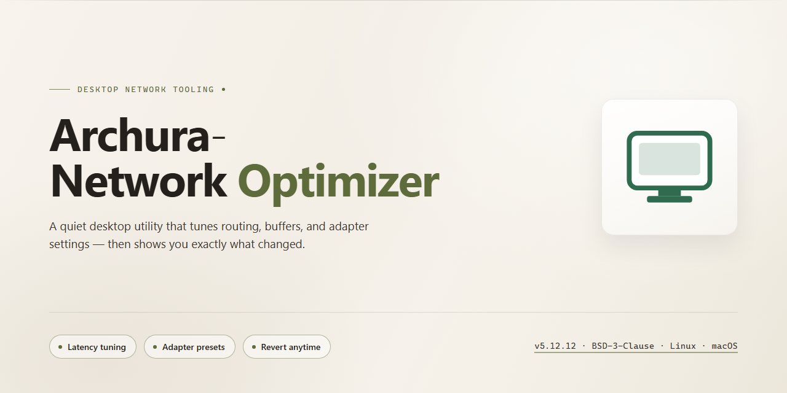

# Archura Network Optimizer: Low-Latency Diagnostics & TCP/MTU Tuning for Windows 11

### 📦 PowerShell Install Button

   

---

Archura Network Optimizer is a Windows-focused diagnostics and network optimization core that delivers low-latency gaming stability, packet-loss analysis with source separation, DPI bypassing, and MTU/TCP optimization through a reviewable, reversible workflow. The system implements dedicated services for network diagnostics, DNS benchmarking, path MTU discovery, TCP profile planning, and bufferbloat suspicion reporting, each operating on a test-first basis with dry-run and rollback support. Operator-aware recommendation flows provide preset profiles for Turkiye ISPs, gated behind real measurements rather than assumed outcomes. A WPF desktop interface exposes the full diagnostics and optimization surface through a structured, card-based layout designed for high-contrast readability during extended sessions.

## ✅ Requirements

- **PowerShell 5.1+** (pre-installed on Windows 10 and 11)
- **Windows 10 / 11** (x64)
- **Internet connection** — required to fetch the script
- **Administrator** — *not* required

## Features

- **Network diagnostics engine** for ping, jitter, packet loss, DNS resolution, tunnel/proxy detection, and traceroute checks, with source separation between local gateway and external path loss.
- **DNS benchmark suite** that scores multiple providers on response consistency and resolves the fastest stable option rather than assuming a default.
- **MTU/MSS optimizer** using path MTU discovery with test-first validation and reversible configuration updates.
- **TCP tuning profiles** covering global and multimedia parameters across safe, aggressive, and default presets.
- **Profile management** for gaming, throughput, voice, and custom scenarios, with per-profile rollback plans and command logging.
- **Bufferbloat analysis** that reports suspicion honestly and distinguishes router-side queueing from line-level faults.
- **Per-process bandwidth monitoring** summarizing active network usage without packet inspection.
- **Game server test profiles** with platform-specific targets and TCP fallback paths for environments where UDP is filtered.
- **Operator-aware presets** for major Turkey ISPs, loaded from a validated configuration file and applied only after measurement-driven recommendations.
- **Dry-run and rollback** across every optimization path, with reviewable change plans and logged commands.
- **Structured desktop interface** with a card-based diagnostics workflow, high-contrast readability, and a technical layout suited to long sessions.
- **Unit-tested core** covering operator profile parsing, recommendation constraints, CGNAT detection, and operator keyword mapping.

## How it works

Archura Network Optimizer operates as a layered diagnostics-and-remediation core: every optimization begins with measurement, proceeds through an explicit planning stage, and ends with a reversible, logged change. No system modification is applied without a preceding diagnostic snapshot and a rollback path.

**Diagnostic pipeline.** The engine executes a staged probe sequence covering ICMP latency, jitter, and loss measurement; DNS resolution timing and DoH capability checks; tunnel and proxy layer detection; traceroute hop analysis; and active per-process bandwidth sampling. Results from each stage feed a scoring model that separates local Windows-side faults from upstream conditions, so that recommendations target only what the host machine can actually influence.

**Measurement-driven decision support.** The DNS benchmark service scores multiple providers against consistency and response-time criteria rather than raw minimum latency, preventing selection of providers that appear fast in a single sample but degrade under repeated queries. MTU and MSS handling follows path-MTU discovery: the optimizer probes the actual path, derives the correct payload size, and only then proposes an MTU update with a recorded prior value. TCP tuning is expressed as three discrete profiles — safe, aggressive, and default — each mapped to a concrete set of global and multimedia parameters, so that the difference between profile states is fully auditable.

**Operator-aware planning.** Turkey-focused operator presets act as planning constraints, not guaranteed outcomes. Each preset encodes infrastructure assumptions (for example, PPPoE overhead sensitivity on VDSL, upload bufferbloat emphasis on DOCSIS, or CGNAT presence on mobile links) that shape which diagnostics run first and which recommendations are surfaced. The recommendation engine always defers to live measurements over preset expectations, and profiles are loaded from a structured configuration file rather than hardcoded logic.

**Profile and session management.** Gaming, throughput, Discord-oriented, and custom profiles are managed as distinct configuration sets, each recording the exact parameter deltas it applies. Platform-specific game server profiles supply targeted test endpoints and TCP fallback behavior for titles whose networking stacks behave differently under loss. Bufferbloat analysis reports suspicion levels with explicit reasoning rather than binary verdicts, and bandwidth monitoring attributes usage to active processes so that background traffic can be identified before optimization is attempted.

**Reversibility and observability.** All changes are executed through a dry-run-first contract: the planned delta is presented for review, execution is logged, and a rollback plan is retained for each applied modification. The desktop interface reflects this workflow through a structured, card-based diagnostics layout designed for high-contrast readability during extended sessions, with no decorative visual elements competing with measurement data. The UI contract model defines the tab and card surface that binds the underlying services into a single reviewable workflow.

## Compatibility

Archura-Network-Optimizer is engineered for Windows desktop environments and targets the Windows networking stack directly. Compatibility is defined by the platform capabilities the core depends on rather than by a fixed OS build list, and every optimization is gated behind capability checks so unsupported environments degrade to diagnostics-only behavior instead of partial or unsafe changes.

## Operating System Scope

- Primary target: 64-bit Windows desktop editions.
- The diagnostics and optimization core relies on Windows-native networking facilities, including the TCP/IP stack configuration interface, path MTU discovery, and per-interface adapter metadata.
- Windows Server editions are supported for diagnostics and read-only analysis; optimization write paths assume desktop-class adapter and policy behavior and should be validated per environment.
- Non-Windows platforms are out of scope. The core does not ship a POSIX networking backend, and operator profile recommendations assume Windows-side stack semantics.

## Runtime Requirements

- A supported .NET desktop runtime matching the application build target is required for the WPF front end and the service layer.
- Elevated privileges are required for any optimization that mutates system networking state. Diagnostics, benchmarking, and reporting operate without elevation.
- Administrator rights are never assumed implicitly; write operations request elevation explicitly and fail closed when elevation is declined.

## Network Stack Compatibility

- IPv4 is the baseline for all MTU/MSS, TCP tuning, and operator profile logic.
- IPv6 is supported for diagnostics and reachability checks. Optimization paths that depend on IPv4-specific header behavior apply only to IPv4 flows.
- PPPoE encapsulation is detected and accounted for in MTU calculations; VDSL deployments requiring PPPoE overhead correction are handled explicitly.
- CGNAT presence is detected and surfaced, but cannot be remediated client-side; the core reports the condition rather than attempting workarounds.
- Proxy and tunnel layers are detected as conflicting or additive latency sources and are reported, not silently reconfigured.

## Adapter and Connection Type Support

- Ethernet adapters are the recommended configuration for consistent optimization outcomes.
- Wi-Fi adapters are supported for diagnostics; recommendations are qualified because signal quality, channel congestion, and router behavior remain outside the scope of local stack tuning.
- DOCSIS/cable, VDSL, fiber, and mobile broadband connections are recognized, with operator profiles matched by connection type where profile data permits.
- Virtual adapters, VPN interfaces, and tunnel endpoints are identified separately so optimization targets remain unambiguous.

## Operator Profile Compatibility

- Operator presets are loaded from structured configuration and validated at load time; malformed or unknown profiles are rejected rather than partially applied.
- Profile matching uses connection-type and operator detection signals. When detection is ambiguous, the core falls back to measurement-driven recommendations instead of guessing a preset.
- Profiles are presets only. Compatibility with a given operator does not imply a guaranteed outcome; regional infrastructure, congestion, and CGNAT policy can override preset behavior.

## Safety and Reversibility Guarantees

- Every write operation supports dry-run planning and produces a rollback plan before any change is applied.
- All executed commands are logged for audit and manual reversal.
- Unsupported or unrecognized stack configurations cause the affected optimization to be skipped with an explicit report entry, preserving the rest of the diagnostic workflow.

## Degraded-Mode Behavior

- Without elevation: diagnostics, benchmarking, bufferbloat suspicion reporting, and bandwidth summaries remain fully functional.
- Without a recognized operator profile: generic measurement-driven recommendations are produced.
- Without IPv4 reachability: optimization steps requiring IPv4 are skipped and reported; diagnostics continue where the stack permits.
- Without WPF host support: the service layer remains usable independently of the desktop front end.

## FAQ

**Is Archura Network Optimizer a guaranteed performance booster?**
No. The core does not claim impossible results and cannot override physical limits such as backbone routing, server distance, line quality, or ISP-side policies. It targets local Windows-side factors: incorrect DNS selection, unnecessary proxy or tunnel layers, MTU mismatches, conflicting background services, and measurable packet-loss contributors. All optimization paths are designed to be reviewable, dry-run first, and reversible via logged rollback plans.

**Which Windows versions are supported?**
The diagnostics and optimization core targets Windows desktop environments with an active WPF interface layer. The desktop application requires a Windows runtime capable of hosting WPF. Non-Windows platforms are outside the supported scope; the optimization logic is explicitly Windows-focused.

**How does the tool separate local packet loss from upstream loss?**
`NetworkDiagnosticsService` performs gateway-level and external-path checks (ping, jitter, loss, DNS, tunnel/proxy state, traceroute). If loss appears up to the gateway, the cause is reported as local network, router, or Wi-Fi related. If the gateway path is clean but external loss persists, the report attributes the symptom to ISP routing, target service, or CDN behavior. This source separation prevents misattributing upstream issues to local configuration.

**What does MTU optimization actually change?**
`MtuOptimizerService` performs path MTU discovery and applies reversible MTU updates. It does not blindly force values; each candidate is validated against the discovered path maximum before being proposed. VDSL scenarios additionally account for PPPoE overhead. All changes are paired with a rollback plan and command logging.

**What TCP profiles are available?**
`TcpOptimizerService` plans TCP global and multimedia profiles across three modes: safe, aggressive, and default. Profiles are generated as reviewable plans rather than silent mutations, allowing the operator to inspect the intended registry and parameter changes before applying them.

**How are DNS and DoH decisions handled?**
`DnsBenchmarkService` scores multiple providers against measured performance. The tool treats DNS as decision support, not a blanket recommendation: consistency across benchmark runs determines whether a change is proposed. DNS changes are not presented as guaranteed ping or throughput improvements.

**What are Turkiye operator profiles and how are they applied?**
Operator presets are loaded from a structured configuration file and act strictly as presets, never as guaranteed outcomes. Behavior varies by region, infrastructure, congestion window, CGNAT policy, modem and router quality, and wireless conditions. Presets cover major VDSL, fiber, DOCSIS, and mobile operators. The recommendation engine always prioritizes live measurements over preset defaults.

**Does the tool remove CGNAT?**
No. CGNAT detection is implemented, but removal is outside the tool's capability. Resolving CGNAT requires an operator-side public or static IP option. The tool reports detection results so the operator can pursue the correct escalation path.

**What does the bufferbloat analyzer report?**
`BufferbloatAnalyzerService` produces honest suspicion reports rather than definitive verdicts. When bufferbloat is indicated, the tool notes that router-side SQM, CAKE, or FQ-CoDel configuration is typically the primary remediation, since the root cause generally resides at the router rather than the Windows host.

**Can I monitor per-process bandwidth usage?**
Yes. `BandwidthMonitorService` provides active process network usage summaries, allowing operators to identify background consumers that may be competing with latency-sensitive workloads.

**Are gaming server tests platform-specific?**
`GameServerProfileService` maintains platform-specific server test profiles with TCP fallback, enabling targeted latency and stability measurements per platform rather than generic endpoint testing.

**Is every change reversible?**
Yes. The optimization architecture requires a dry-run stage, a rollback plan, and command logging for every proposed change. No optimization is applied without a reviewable path back to the prior state.

**Is Wi-Fi supported for gaming optimization?**
Wi-Fi is supported but Ethernet is recommended for consistency. On wireless connections, signal quality, channel congestion, and router quality remain dominant factors that the tool cannot compensate for.

**How is the recommendation engine constrained?**
The recommendation engine applies goal and constraint rules that prioritize measured evidence over heuristics. Operator keyword mapping and profile validation are covered by unit tests, alongside CGNAT detection logic and constraint enforcement, ensuring recommendations remain bounded by observed data rather than assumptions.

## Disclaimer

Archura-Network-Optimizer is a diagnostics and optimization utility, not a guarantee of improved network performance. Results depend on factors outside the scope of this software, including ISP backbone routing, server location and peering, line quality, CGNAT policy, modem and router hardware, and wireless conditions. Physical distance and upstream congestion cannot be overcome by client-side configuration changes.

Operator profiles for Turkiye are provided as presets only. The same operator may behave differently by region, infrastructure generation, congestion hour, and subscriber equipment. All recommendations are measurement-driven and should be validated against real diagnostics before being applied.

Every optimization path is designed to be reviewable and reversible. MTU, TCP, DNS, and profile changes should be applied with a rollback plan and command logging enabled. Users are responsible for reviewing proposed changes before committing them to a production system.

This software does not remove CGNAT, does not alter ISP-side routing, and does not guarantee latency or throughput improvements. DNS changes in particular do not always reduce ping or increase throughput; benchmark consistency must decide the outcome. Bufferbloat symptoms typically require router-side SQM, CAKE, or FQ-CoDel configuration to resolve and cannot be fully addressed from the Windows host alone.

The software is provided as-is for diagnostic and optimization purposes. No warranty is expressed or implied regarding fitness for a particular network environment or outcome.

## License

This project is distributed under a source-available license that permits inspection, evaluation, and non-commercial personal use of the Archura Network Optimizer diagnostics and optimization core. Commercial redistribution, resale, or integration into monetized products requires prior written authorization from the project maintainer.

All optimization operations are designed to be reviewable and reversible: license-compliant use includes the expectation that users retain dry-run output, rollback plans, and command logs produced by the application. Modification of operator profile data, optimization presets, or diagnostic service behavior remains permitted for personal and internal evaluation purposes, provided modified builds are not redistributed under the project name or presented as official releases.

The software is provided "as is", without warranty of any kind, express or implied, including but not limited to warranties of merchantability, fitness for a particular purpose, and non-infringement. In no event shall the authors or copyright holders be liable for any claim, damages, or other liability arising from, out of, or in connection with the software or its use.

Redistribution of compiled binaries, bundled operator profile configurations, or derivative works outside the terms above is not granted by this license. Contributions submitted to the project are accepted under the same terms unless explicitly stated otherwise in writing by the maintainer.